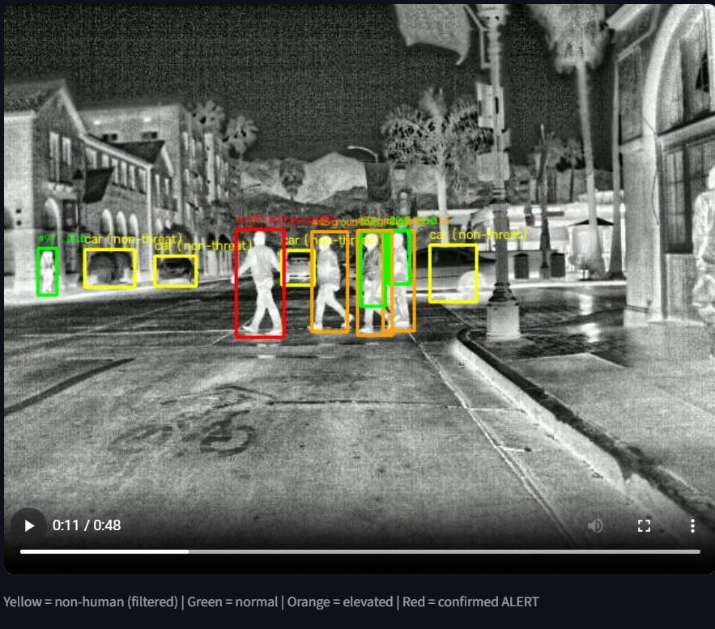
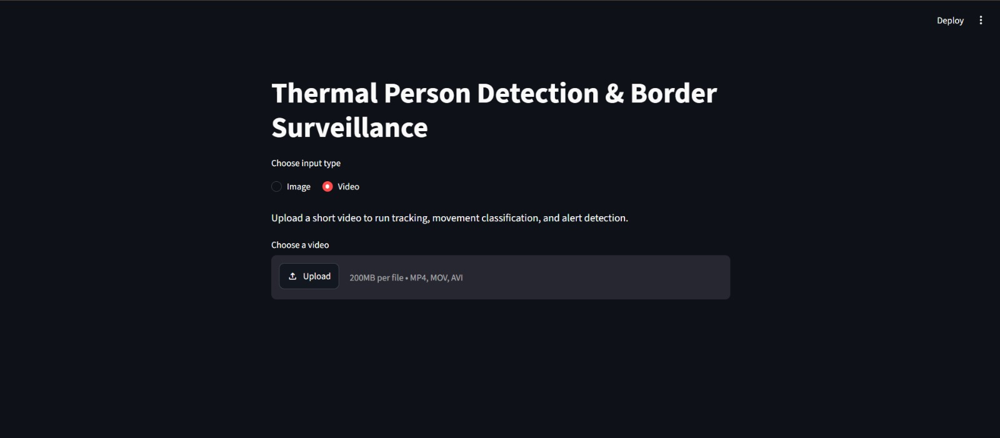
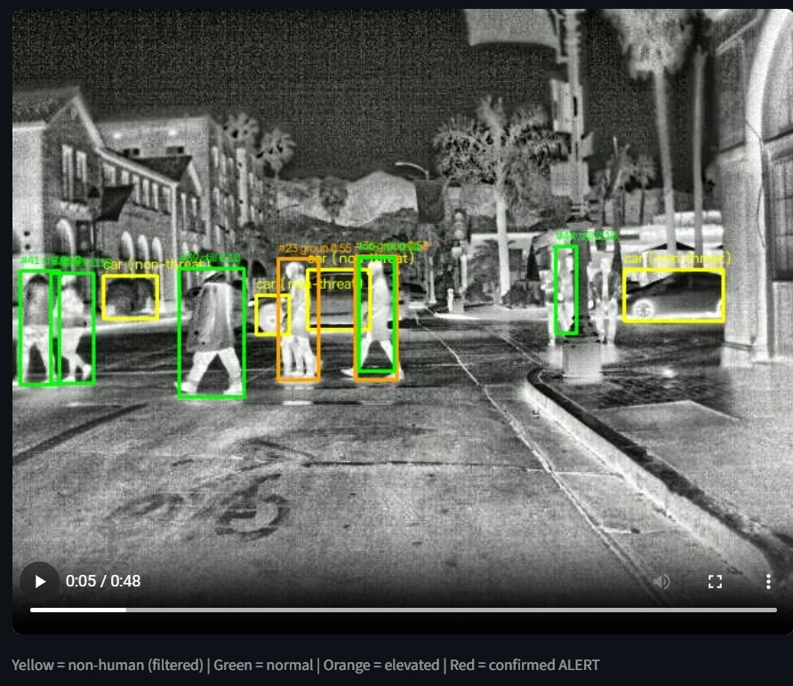
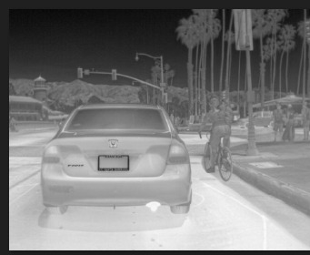
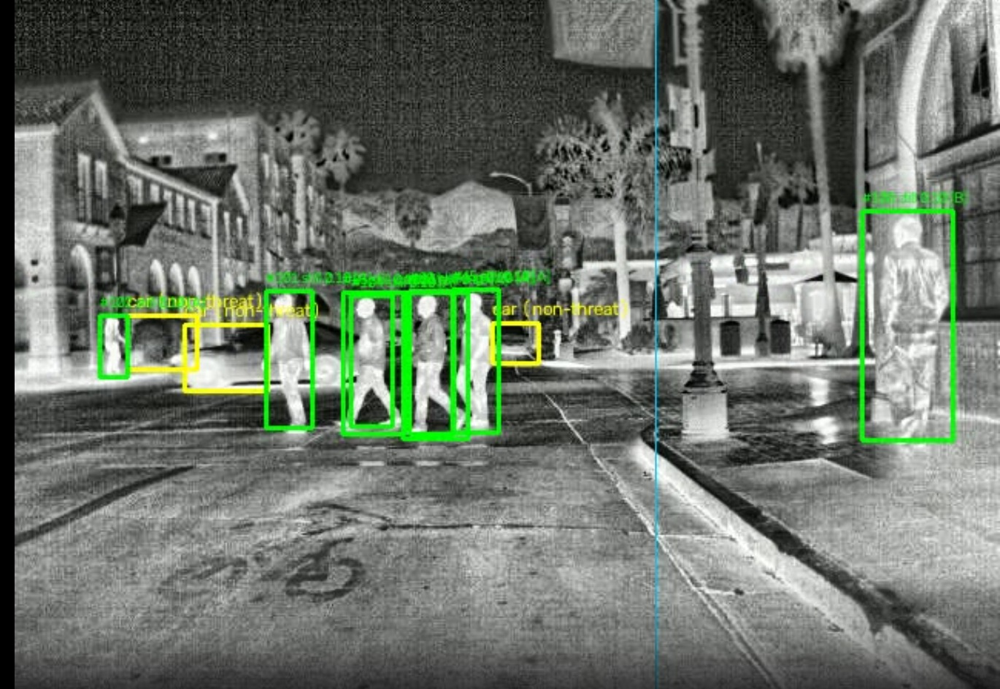
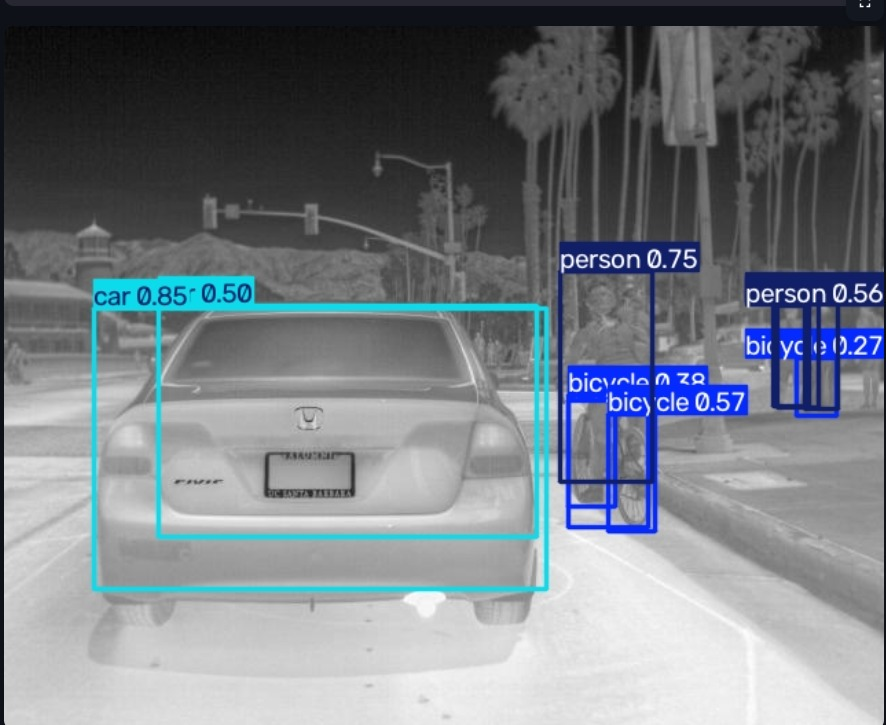

# AI-Based Border Surveillance Using Drones (Thermal Person Detection & Behavior Classification)

Built for Hacker's Cult NSUT Hackathon — AI-3 track (Computer Vision / Security Tech)

## Problem

Manual border/perimeter monitoring is manpower-intensive and prone to fatigue-driven misses,
especially at night. This project processes thermal and low-light video to detect people,
track them across frames, classify their movement behavior, and flag suspicious activity —
distinguishing genuine threats from routine non-human heat sources (vehicles, etc.), not just
detecting "something is there."

## Dataset

- **FLIR Thermal Dataset** (v1i, YOLOv8 format, via Roboflow) — public thermal imagery with
  person/car/bicycle annotations.
- **Limitation:** the dataset is relatively small and imbalanced toward vehicles over people,
  and thermal imagery has inherently lower resolution and no color/texture cues compared to
  RGB data — addressed via CLAHE contrast enhancement (see below).

## Approach

1. **Detection** — YOLOv8n fine-tuned on the FLIR thermal dataset (25 epochs, CPU-trained).
2. **Tracking** — ByteTrack (via Ultralytics) assigns persistent IDs to each person across
   video frames, handling partial occlusion.
3. **Thermal preprocessing** — CLAHE (Contrast Limited Adaptive Histogram Equalization) is
   applied to each frame before detection, to counteract thermal blooming and low contrast.
4. **Movement classification (rule-based, not a separately trained model)** — using each
   tracked person's motion history:
   - **Crouching/crawling** — bounding box height/width ratio drops well below that person's
     own established baseline
   - **Group movement** — 2+ people close together, moving in the same direction at similar
     speed
   - **Normal walking** — default movement; **stationary** if barely moving
5. **False-alarm reduction (2 techniques):**
   - Non-human classes (car, bicycle) are explicitly detected and labeled "non-threat
     (filtered)" rather than ignored
   - Suspicious behavior must persist for several consecutive frames before becoming a
     confirmed **ALERT** — a single noisy frame won't trigger a false alarm
6. **Multi-camera fusion (simulated, disclosed):** true multi-physical-camera fusion is a
   research-level problem outside hackathon scope. This is a disclosed simulation: the video
   frame is split into two overlapping "virtual camera" zones; a person seen in the overlap
   zone is treated as cross-camera confirmed, with a suspicion-confidence boost — demonstrating
   the actual fusion decision logic on a single real feed.
7. **Output** — bounding-box-and-alert overlay directly on the video (not a terminal log),
   with a live confidence/suspicion score per tracked person.

## Results

- Training: 100 epochs, YOLOv8n, CPU, ~6.5 hours
- Visually confirmed accurate person/vehicle detection on validation images and real video
  footage (see `/demo_screenshots`)
- Note: the automated mAP metric reported at the end of training was affected by an unrelated
  library bug (`polars`) and did not reflect true performance validated instead via direct
  visual inspection of predictions on held-out images and video.

## Honest limitations

- Movement classification is rule-based/heuristic, not a separately trained and validated
  classifier  a reasonable approach given the time constraints, but not empirically validated
  against ground-truth behavior labels.
- Detection confidence is moderate (typically 0.2–0.9), consistent with a small (`yolov8n`)
  model trained briefly on CPU.
- Multi-camera fusion is simulated on a single feed, not tested with genuine multi-camera
  hardware.

## Demo

- Streamlit app (`app.py`) — supports both single-image and full video pipeline (tracking +
  classification + alerts) with a live browser demo.
- Standalone script (`track_analyze.py`) — same full pipeline, run from the command line on
  any video file.

### Demo Screenshots

| | |
|---|---|
|  |  |
|  |  |
|  |  |

## Architecture & Modern Web Stack

- **Backend:** Python **FastAPI** (ackend/main.py)
  - Endpoints for thermal image detection (POST /api/detect/image), asynchronous video ByteTrack pipeline (POST /api/detect/video, GET /api/detect/video/status/{task_id}), and WebSocket live camera sentinel (/api/ws/live).
  - CLAHE contrast equalization, movement classification (crouching, group motion, walking, stationary), and simulated dual-camera fusion.
  - Automatically serves the compiled Angular web dashboard directly on http://localhost:8000.
- **Frontend:** **Angular 19** (rontend/)
  - Tactical military C2 dark-mode interface with live system telemetry HUD.
  - Tab 1: Thermal Image Analysis (confidence tuning, CLAHE toggle, confidence bars).
  - Tab 2: Thermal Video Surveillance (asynchronous ByteTrack tracking, multi-zone fusion diagnostics, alert confirmation banner, H.264 video playback and download).
  - Tab 3: Live Camera Threat Sentinel (real-time low-latency WebSocket streaming, aspect-ratio crouch detection, centroid tracker, speed and proximity radar).

## Setup & Running

### 1. Install Backend Dependencies
`ash
pip install -r requirements.txt
`

### 2. Start the FastAPI Backend
`ash
python run_backend.py
# Or double click start_backend.bat
`
The FastAPI backend will start at http://localhost:8000.
Since the production Angular frontend is pre-built into rontend/dist/frontend/browser, opening http://localhost:8000 will load the complete surveillance dashboard!
API documentation is also available at http://localhost:8000/docs.

### 3. Optional: Run Angular in Development Mode (Hot Reloading)
`ash
cd frontend
pnpm install
pnpm start
# Or double click start_frontend.bat
`
The development dashboard will run at http://localhost:4200 connected to http://localhost:8000.

## Files

- ackend/ - FastAPI application and services
  - main.py - REST API routes, WebSocket streamer, and static mount
  - config.py - system and surveillance configuration
  - services/thermal_service.py - YOLOv8 thermal image inference and CLAHE
  - services/video_service.py - ByteTrack tracking, behavior classification, fusion, and ffmpeg
  - services/live_service.py - live centroid tracker and threat classification
- rontend/ - Modern Angular 19 tactical surveillance application
- 
un_backend.py - quick-start entrypoint for the FastAPI server
- 	rain.py - model training script
- 
esume.py - resume training from a checkpoint
- 	rack_analyze.py - full detection + tracking + classification + alert pipeline (CLI)
- make_demo_video.py - utility to synthesize a demo video from dataset images
- data.yaml - dataset config

## Citation
If you use this work or codebase, please cite the research paper:

```bibtex
@misc{sethi2026thermalguard,
  author       = {Sidak Singh Sethi},
  title        = {{Autonomous Drone Thermal Surveillance: Edge-Optimized YOLOv8 Detection, ByteTrack Kinematics, and Heuristic Threat Classification for Border Security}},
  year         = {2026},
  publisher    = {Zenodo},
  doi          = {10.5281/zenodo.23423684},
  url          = {[https://doi.org/10.5281/zenodo.23423684](https://doi.org/10.5281/zenodo.23423684)}
}
